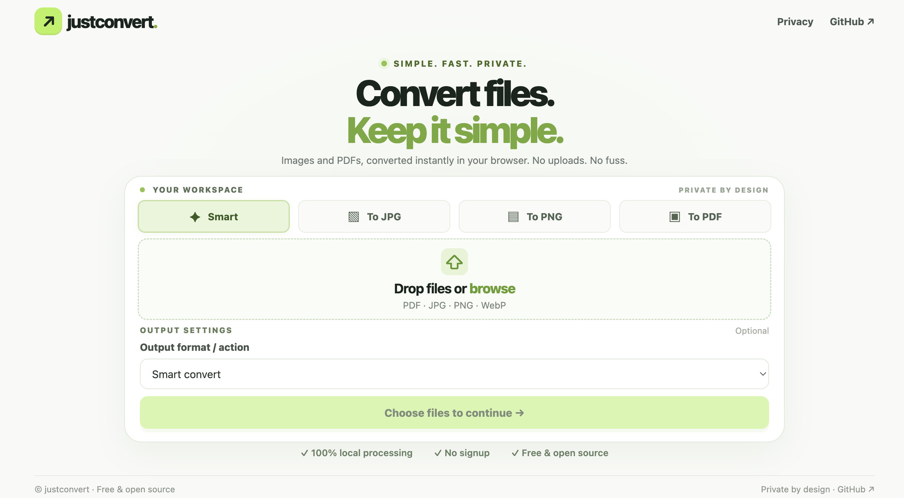
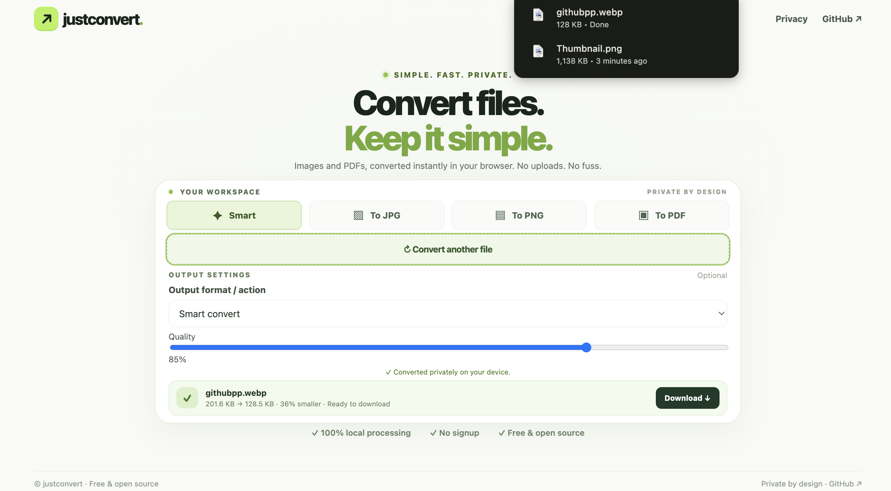
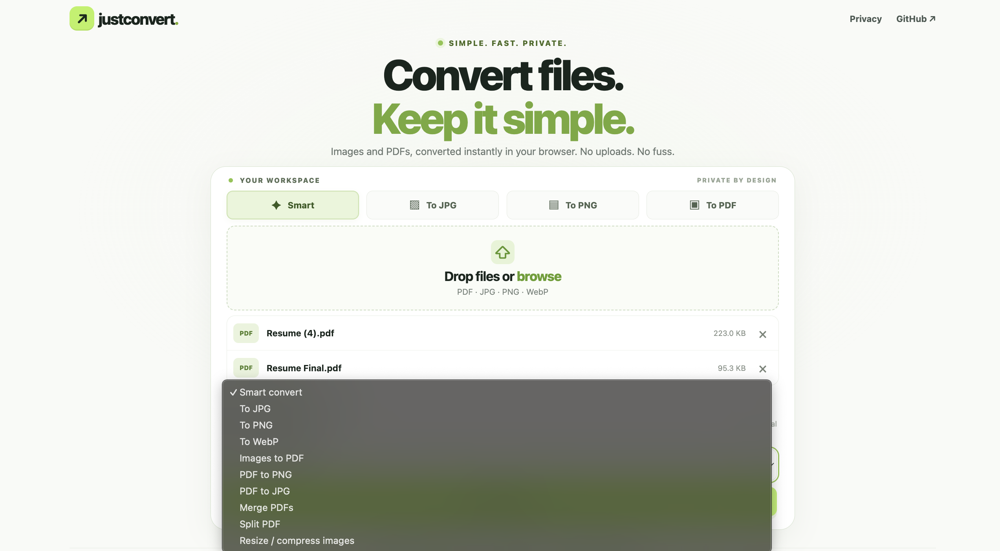

# JustConvert

A free, open-source tool for converting images and working with PDFs directly in your browser.

[](https://github.com/AnamolAdhikari/JustConvert/actions/workflows/ci.yml) [](LICENSE)

**[Try JustConvert](https://justconvert.n90.workers.dev/)** · **[Report an issue](https://github.com/AnamolAdhikari/JustConvert/issues)** · **[Contribute](CONTRIBUTING.md)**



### A look at JustConvert

| Converter | More tools |
| --- | --- |
|  |  |

JustConvert is built for everyday file tasks without the extra steps. Open the website, choose your files, and download the results. There is no account to create, and files are processed locally in your browser rather than uploaded to an application server.

## What you can do

- Convert images between JPG, PNG, and WebP.
- Resize and compress images.
- Turn images into a PDF.
- Export PDF pages as PNG or JPG images.
- Merge several PDFs into one file or split a PDF.
- Process multiple files and download the results as a ZIP.

## Getting started

You can use the [live website](https://justconvert.n90.workers.dev/) without installing anything.

To run the project locally, you'll need Node.js and npm:

```bash
git clone https://github.com/AnamolAdhikari/JustConvert.git
cd JustConvert
npm install
npm run dev
```

Open the local URL shown in your terminal.

## Privacy

File processing happens in your browser. JustConvert does not implement a server endpoint for uploading your files.

The website still needs a network connection to load the application and its dependencies. As with any website, normal hosting requests may occur.

## File limits

These limits help prevent large jobs from exhausting browser memory:

- Up to 100 MB per input file.
- Up to 30 files or 250 MB in a batch.
- Images larger than 40 megapixels are not accepted.
- PDF-to-image export supports up to 100 pages, with a 40-megapixel limit for rendered pages.

Your browser and device may have lower practical limits. Large files can take longer to process, and some PDFs may not work, including password-protected or damaged files. PDF pages exported as images are rasterized, and available image encoding options can vary by browser.

## Development and testing

JustConvert uses Vite, JavaScript, pdf-lib, PDF.js, and JSZip. The automated browser tests use Playwright.

```bash
npm test
npm run build
npx playwright install
npm run test:e2e
```

The end-to-end suite covers Chromium, Firefox, and WebKit. Automated tests help catch regressions, but they cannot guarantee identical behavior on every device.

## Contributing

JustConvert is a small open-source project, and feedback is welcome. If something doesn't work as expected or you have an idea for an improvement, [open an issue](https://github.com/AnamolAdhikari/JustConvert/issues). For code contributions, see the [contribution guide](CONTRIBUTING.md) and browse [open issues](https://github.com/AnamolAdhikari/JustConvert/issues).

If JustConvert saved you time, consider [starring the repository](https://github.com/AnamolAdhikari/JustConvert). It helps others discover the project.

## License

JustConvert is available under the [MIT License](LICENSE).
